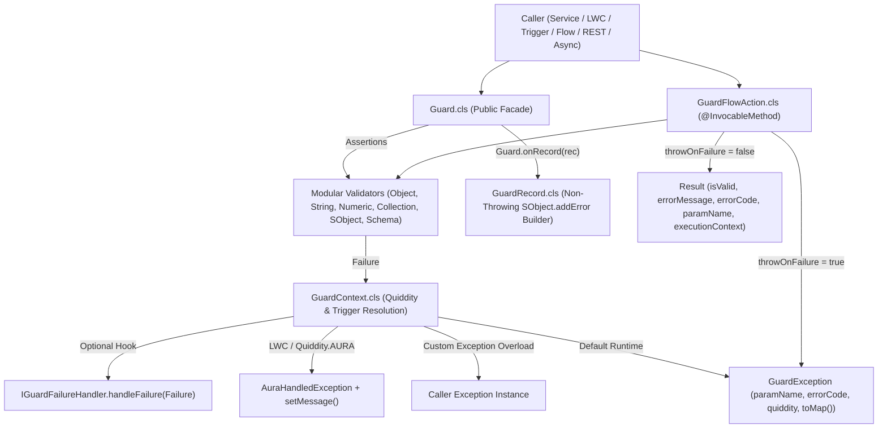

Every mature Salesforce org eventually develops a familiar visual signature inside its Apex codebase: code that marches steadily across the screen to the right before marching back to the left. Before a single line of business logic runs, three to five layers of defensive `if` statements check whether an `Id` is valid, whether a `String` is blank, whether a `Decimal` is positive, whether a `List` has elements, and whether an `SObject` field was actually queried.

We call this the **Arrow Anti-Pattern**. In this post, we'll look at why defensive validation in Salesforce becomes uniquely fragmented across Services, Triggers, Lightning Web Components (LWC), and Flows—and how we built [**ApexGuard**](https://github.com/masaner/apex-guard), a zero-dependency, open-source Apex Guard Clause library modeled after Microsoft's `.NET CommunityToolkit.Diagnostics.Guard`.

---

## The Arrow Anti-Pattern

In a simple backend service, throwing an `IllegalArgumentException` when an input is bad is straightforward. In Salesforce, however, Apex executes across at least half a dozen distinct runtimes within the same org:

1. **Standard Apex Services & Selectors** expect structured exceptions carrying parameter metadata and machine-readable error codes.
2. **`@AuraEnabled` LWC / Aura Controllers** require `AuraHandledException`—and trigger the infamous `"Script-thrown exception"` client error if a developer forgets to call `setMessage()` after instantiating the exception.
3. **Apex Triggers & Partial DML (`Database.insert(records, false)`)** must _not_ abort an entire batch over a single dirty record; they need field-level `record.addError(field, message)` attachments so valid sibling records succeed and Lightning Record Pages highlight the offending field.
4. **Flows & Agentforce Invocable Actions (`@InvocableMethod`)** sometimes want to throw into a Flow Fault connector, and other times want structured output booleans (`isValid`, `errorMessage`, `errorCode`) to branch cleanly in a Decision element.

When every team invents ad-hoc defensive checks for each surface, you end up with deeply nested methods like this:

```apex
// ❌ Before: Pyramid of Doom + Fragile Validation Boilerplate
public with sharing class BillingInvoiceService {
    public CreditMemoResult issueCreditMemo(
        String rawAccountId,
        Decimal creditAmount,
        String reasonCode,
        List<OpportunityLineItem> lineItems,
        Account billedAccount
    ) {
        if (!String.isBlank(rawAccountId) && (rawAccountId.length() == 15 || rawAccountId.length() == 18)) {
            Id accountId;
            try {
                accountId = Id.valueOf(rawAccountId);
            } catch (Exception ex) {
                throw new IllegalArgumentException('rawAccountId must be a valid Salesforce Id.');
            }

            if (accountId.getSObjectType() == Account.SObjectType) {
                if (creditAmount != null && creditAmount >= 0.01 && creditAmount <= 50000.00) {
                    if (!String.isBlank(reasonCode)) {
                        if (lineItems != null && !lineItems.isEmpty()) {
                            if (
                                billedAccount != null &&
                                billedAccount.isSet(Account.BillingCountry) &&
                                billedAccount.BillingCountry != null
                            ) {
                                // Actual business logic finally starts at indentation level 6...
                                return processCreditMemo(
                                    accountId,
                                    creditAmount,
                                    reasonCode,
                                    lineItems,
                                    billedAccount
                                );
                            } else {
                                throw new IllegalArgumentException('billedAccount.BillingCountry is required.');
                            }
                        } else {
                            throw new IllegalArgumentException('lineItems must not be empty.');
                        }
                    } else {
                        throw new IllegalArgumentException('reasonCode must not be blank.');
                    }
                } else {
                    throw new IllegalArgumentException('creditAmount must be between 0.01 and 50000.00.');
                }
            } else {
                throw new IllegalArgumentException('rawAccountId must reference an Account.');
            }
        } else {
            throw new IllegalArgumentException('rawAccountId must be a valid 15- or 18-character Id.');
        }
    }
}
```

Notice the hidden bugs lurking even inside conscientious boilerplate like this:

- Someone almost always forgets `billedAccount.isSet(Account.BillingCountry)` before accessing `billedAccount.BillingCountry`—producing an unhandled `System.SObjectException` if the caller queried `Account` without selecting `BillingCountry` (or stripped it via `Security.stripInaccessible()`).
- Repeating the same rule across an `@AuraEnabled` controller requires duplicating those six `if` blocks and remembering `auraEx.setMessage(...)` in every single branch.
- Catching `IllegalArgumentException` downstream tells telemetry tools almost nothing without fragile string parsing.

---

## Positive-Assertion Pass-Throughs

Rather than writing negative `against...` helpers (`Against.nullOrEmpty(...)`), **ApexGuard** adopts the positive-assertion naming convention of `.NET CommunityToolkit.Diagnostics.Guard`: every method on the public [`Guard.cls`](https://github.com/masaner/apex-guard/blob/main/force-app/main/default/classes/core/Guard.cls) facade is named after the **valid precondition required for execution to proceed**:

- `Guard.isNotNull(...)` / `Guard.isNull(...)`
- `Guard.isTrue(...)` / `Guard.isFalse(...)`
- `Guard.isNotEmpty(...)` / `Guard.isNotBlank(...)` / `Guard.hasLengthEqualTo(...)` / `Guard.hasMaxLength(...)` / `Guard.matchesRegex(...)`
- `Guard.isGreaterThan(...)` / `Guard.isGreaterThanOrEqualTo(...)` / `Guard.isLessThan(...)` / `Guard.isLessThanOrEqualTo(...)` / `Guard.isInRange(...)` / `Guard.isNotZero(...)`
- `Guard.isNotEmpty(...)` / `Guard.hasSizeEqualTo(...)` / `Guard.containsKey(...)`
- `Guard.isValidId(...)` / `Guard.isIdOfType(...)` / `Guard.isSObjectType(...)` / `Guard.hasPopulatedField(...)`
- `Guard.isAccessible(...)` / `Guard.isCreateable(...)` / `Guard.isUpdateable(...)` / `Guard.isDeletable(...)` / `Guard.isFieldAccessible(...)` / `Guard.isFieldCreateable(...)` / `Guard.isFieldUpdateable(...)`

Equally important: wherever sensible, **guard methods return the validated value**. That means validation and local variable assignment collapse into a single self-documenting line.

Here is that same `BillingInvoiceService.issueCreditMemo` method refactored with `ApexGuard`:

```apex
// ✅ After: Flat, Self-Documenting Pass-Through Guard Clauses
public with sharing class BillingInvoiceService {
    public CreditMemoResult issueCreditMemo(
        String rawAccountId,
        Decimal creditAmount,
        String reasonCode,
        List<OpportunityLineItem> lineItems,
        Account billedAccount
    ) {
        Id accountId = Guard.isIdOfType(
            Guard.isValidId(rawAccountId, 'rawAccountId'),
            Account.SObjectType,
            'rawAccountId'
        );
        Decimal validatedAmount = Guard.isInRange(
            creditAmount,
            0.01,
            50000.00,
            'creditAmount'
        );
        String validatedReason = Guard.isNotBlank(reasonCode, 'reasonCode');
        Guard.isNotEmpty(lineItems, 'lineItems');
        Account validatedAccount = (Account) Guard.hasPopulatedField(
            Guard.isSObjectType(billedAccount, Account.SObjectType, 'billedAccount'),
            Account.BillingCountry,
            'billedAccount'
        );

        return processCreditMemo(
            accountId,
            validatedAmount,
            validatedReason,
            lineItems,
            validatedAccount
        );
    }
}
```

Nesting drops from **6 levels to 1**. Every invariant (`Account.SObjectType`, inclusive `[0.01, 50000.00]` range, non-blank `reasonCode`, non-empty `lineItems`, populated `Account.BillingCountry`) is readable top-to-bottom at a glance—and failing any of them throws a structured `GuardException` with standardized diagnostics:

> `"Parameter 'creditAmount' must be between 0.01 and 50000.00 (inclusive), but was 75000."`

### Handling Apex's Collection Type-System Quirk

One early design hurdle in Apex is that collection polymorphism is asymmetric:

- `List<T>` is **covariant**: a `List<Account>` or `List<OpportunityLineItem>` converts implicitly to `List<Object>`.
- `Set<T>` is **invariant**: passing a `Set<Id>` or `Set<String>` to a method expecting `Set<Object>` fails to compile.
- `Map<K, V>` has **invariant keys**: `Map<Id, Account>` does not convert to `Map<Object, Object>`. Meanwhile, adding both `Map<String, Object>` and `Map<String, SObject>` causes an Apex compiler _ambiguous method signature_ error because `Account` satisfies both `SObject` and `Object`.

Inside [`GuardCollectionValidator.cls`](https://github.com/masaner/apex-guard/blob/main/force-app/main/default/classes/validators/GuardCollectionValidator.cls) and [`Guard.cls`](https://github.com/masaner/apex-guard/blob/main/force-app/main/default/classes/core/Guard.cls), we solved this with explicit, zero-copy overloads for:

- `List<Object>` (`isNotEmpty`, `hasSizeEqualTo`)
- `Set<Object>`, `Set<Id>`, `Set<String>`, and `Set<Integer>` (`isNotEmpty` for all four; `hasSizeEqualTo` for `Set<Object>`, `Set<Id>`, `Set<String>`)
- `Map<Object, Object>`, `Map<Id, SObject>`, `Map<String, Object>`, and `Map<String, String>` (`isNotEmpty` and `containsKey` for all four; `hasSizeEqualTo` for `Map<Object, Object>`, `Map<Id, SObject>`, and `Map<String, Object>`)

Developers write `Guard.isNotEmpty(accountIds, 'accountIds')` or `Guard.containsKey(accountsById, targetId, 'accountsById')` without allocating wrapper collections or converting types—and get typed `Set<Id>` or `Map<Id, SObject>` pass-through returns out of the box.

---

## Execution Context Routing

A guard library that only throws one generic `Exception` falls short the moment you leave a synchronous service class. We structured `ApexGuard` around a single public facade (`Guard.cls`), six modular validator classes, a fluent trigger builder (`GuardRecord.cls`), an invocable Flow action (`GuardFlowAction.cls`), and a central runtime router (`GuardContext.cls`):



| Execution Context            | Entry Point                                    | Failure Behavior                                              | Key Metadata / Output                                      |
| :--------------------------- | :--------------------------------------------- | :------------------------------------------------------------ | :--------------------------------------------------------- |
| Standard Apex / REST / Async | `Guard.*`                                      | Throws `GuardException` (or caller exception)                 | `paramName`, `errorCode`, `quiddity`, `toMap()`            |
| Lightning Web Components     | `Guard.*` (`Quiddity.AURA`) / `Guard.forLwc()` | Throws `AuraHandledException` with `setMessage()`             | Preserves message instead of `"Script-thrown exception"`   |
| Triggers & Partial DML       | `Guard.onRecord(SObject)`                      | Non-throwing `record.addError(field, message)`                | `.hasErrors()`, `.isValid()`, `.getErrorMessages()`        |
| Flows & Agentforce           | `GuardFlowAction` (`@InvocableMethod`)         | Throws on fault (`throwOnFailure = true`) or returns `Result` | `isValid`, `errorMessage`, `errorCode`, `executionContext` |

Let's examine how each execution context behaves at runtime.

### 1. Standard Apex, REST APIs & Async Apex (`GuardException`, Custom Exceptions & `IGuardFailureHandler`)

When no special UI override is active, [`GuardContext.cls`](https://github.com/masaner/apex-guard/blob/main/force-app/main/default/classes/context/GuardContext.cls) constructs a [`GuardException.cls`](https://github.com/masaner/apex-guard/blob/main/force-app/main/default/classes/exceptions/GuardException.cls) populated with rich runtime metadata rather than just a plain text message:

- `ex.getParamName()` — `'creditAmount'`
- `ex.getErrorCode()` — one of 30 standardized constants such as `GuardException.ERR_OUT_OF_RANGE` (`'GUARD_OUT_OF_RANGE'`) or `GuardException.ERR_INVALID_ID` (`'GUARD_INVALID_ID'`)
- `ex.getActualValue()` — offending runtime value
- `ex.getQuiddity()` — captured `System.Quiddity` (`REST`, `QUEUEABLE`, `BATCH_APEX`, `SYNCHRONOUS`, etc.)
- `ex.getExecutionContext()` — normalized label (`'TRIGGER'` when `Trigger.isExecuting`, else `String.valueOf(quiddity)`)
- `ex.toMap()` — returns a `Map<String, Object>` (`message`, `paramName`, `errorCode`, `actualValue`, `quiddity`, `executionContext`) ready for JSON serialization in `@RestResource` HTTP 400 handlers or `System.Finalizer` async error loggers without parsing message strings.

Every `Guard` method also ships three overloads:

1. Default message: `(value, paramName)`
2. Custom message: `(value, paramName, customMessage)` (retaining `GuardException` metadata)
3. Custom exception instance: `(value, customException)`

For enterprise orgs using **Nebula Logger** or a Trigger Dispatcher, [`IGuardFailureHandler.cls`](https://github.com/masaner/apex-guard/blob/main/force-app/main/default/classes/context/IGuardFailureHandler.cls) provides a transaction-scoped hook (`Guard.setFailureHandler(handler)`). Whenever any guard fails, `GuardContext` constructs an immutable `GuardContext.Failure` payload and invokes `handler.handleFailure(failure)` right before throwing—allowing teams to log `failure.toGuardException().toMap()` or translate into custom domain exceptions while keeping `ApexGuard` core 100% dependency-free.

### 2. Lightning Web Components (`Quiddity.AURA` & `AuraHandledException.setMessage()`)

One of Apex's longest-standing gotchas hits `@AuraEnabled` controllers: writing `throw new AuraHandledException('Budget must be greater than zero.');` often surfaces as `"Script-thrown exception"` instead of your actual message in unit tests and certain LWC error handlers unless you explicitly invoke `setMessage()`.

Inside [`GuardContext.createAuraHandledException(String message)`](https://github.com/masaner/apex-guard/blob/main/force-app/main/default/classes/context/GuardContext.cls), `ApexGuard` guarantees both steps run every time:

```apex
public static AuraHandledException createAuraHandledException(String message) {
    String safeMessage = String.isBlank(message) ? 'Validation failed.' : message;
    AuraHandledException auraEx = new AuraHandledException(safeMessage);
    auraEx.setMessage(safeMessage);
    return auraEx;
}
```

How does `Guard` know when to throw `AuraHandledException`? `GuardContext.shouldThrowAuraException()` returns `true` automatically whenever `System.Request.getCurrent().getQuiddity() == System.Quiddity.AURA` (with auto-detection enabled by default, configurable via `Guard.setAutoDetectAuraQuiddity(false)`).

And because `@IsTest` methods run under `SYNCHRONOUS` Quiddity by default, `Guard.forLwc()` returns a `GuardContext.LwcScope` wrapper that forces `AuraHandledException` wrapping explicitly—either per expression or in statement mode via `Guard.forLwc();` and `Guard.disableLwcMode();`:

```apex
@AuraEnabled
public static Account updateQuarterlyBudget(String accountIdStr, Decimal budget) {
    Id accountId = Guard.forLwc().isIdOfType(
        Guard.forLwc().isValidId(accountIdStr, 'accountIdStr'),
        Account.SObjectType,
        'accountIdStr'
    );
    Guard.forLwc().isUpdateable(Account.SObjectType);
    Guard.forLwc().isFieldUpdateable(Account.AnnualRevenue);
    Guard.forLwc().isGreaterThan(budget, 0, 'budget');

    Account acc = new Account(Id = accountId, AnnualRevenue = budget);
    update as user acc;
    return acc;
}
```

### 3. Triggers & Bulk DML (`Guard.onRecord(SObject)`)

In an Apex Trigger, throwing an uncaught `GuardException` inside a `for (Opportunity opp : Trigger.new)` loop breaks the entire transaction—defeating `Database.insert(records, false)` partial success and hiding per-field errors in the Lightning UI.

Yet Triggers _still_ need fail-fast structural guards at the top of the handler, plus clean record validation inside the loop. `ApexGuard` separates those two responsibilities cleanly:

- Use static `Guard.*` assertions for **batch/structural preconditions** (`Guard.isNotEmpty(Trigger.new, 'Trigger.new')`).
- Use fluent **`Guard.onRecord(SObject record)`** ([`GuardRecord.cls`](https://github.com/masaner/apex-guard/blob/main/force-app/main/default/classes/core/GuardRecord.cls)) for **non-throwing per-record validation**. Failures call `record.addError(field, message)` (or `record.addError(message)` for arbitrary parameter checks) and record each error so you can inspect `.hasErrors()`, `.isValid()`, or `.getErrorMessages()` after chaining:

```apex
public with sharing class OpportunityTriggerHandler {
    public static void beforeSave(List<Opportunity> newList) {
        // Structural precondition (throws GuardException if null/empty)
        Guard.isNotEmpty(newList, 'newList');

        for (Opportunity opp : newList) {
            // Non-throwing per-record validation — attaches field-level errors via SObject.addError()
            Guard.onRecord(opp)
                .isNotBlank(Opportunity.Name)
                .hasMaxLength(Opportunity.NextStep, 255)
                .isGreaterThan(Opportunity.Amount, 0)
                .isInRange(Opportunity.Probability, 10, 90);
        }
    }
}
```

When a user edits an Opportunity in Lightning Experience and saves with `Amount = -100` and `Probability = 120`, both fields light up simultaneously with pinpointed field messages, and valid records in a bulk Data Loader batch commit cleanly.

### 4. Flows & Agentforce (`GuardFlowAction` `@InvocableMethod`)

Declarative builders and Agentforce agents deserve the same defensive standards without rewriting validation Apex per object. [`GuardFlowAction.cls`](https://github.com/masaner/apex-guard/blob/main/force-app/main/default/classes/invocable/GuardFlowAction.cls) exposes a bulkified `@InvocableMethod(label='Validate Input (ApexGuard)' ...)` supporting 18 scalar and SObject rules (`IS_NOT_NULL`, `IS_NULL`, `IS_TRUE`, `IS_FALSE`, `IS_NOT_EMPTY`, `IS_NOT_BLANK`, `HAS_LENGTH_EQUAL_TO`, `HAS_MAX_LENGTH`, `MATCHES_REGEX`, `IS_GREATER_THAN`, `IS_GREATER_THAN_OR_EQUAL_TO`, `IS_LESS_THAN`, `IS_LESS_THAN_OR_EQUAL_TO`, `IS_IN_RANGE`, `IS_NOT_ZERO`, `IS_VALID_ID`, `IS_ID_OF_TYPE`, and `IS_SOBJECT_TYPE`).

Two design details make `GuardFlowAction` work smoothly across every Flow type:

- **`throwOnFailure` Routing (`true` by default):** Leave `throwOnFailure` omitted or `true` when you want bad input to jump straight into a **Flow Fault** path. Set `throwOnFailure = false` in Screen Flows or Agentforce topics to suppress the throw and return `Result.isValid = false`, `Result.errorMessage`, `Result.errorCode`, `Result.paramName`, and `Result.executionContext` for a **Decision** element or graceful conversational recovery.
- **Screen Flows vs. Record-Triggered Flows (`Quiddity`):** Screen Flows, Autolaunched Flows, and Agentforce Actions execute under `System.Quiddity.INVOCABLE_ACTION`, whereas Record-Triggered Flows invoking Apex often execute under `System.Quiddity.SYNCHRONOUS` or alongside DML trigger context. Because `GuardContext.getExecutionContextName()` checks `Trigger.isExecuting` first and otherwise captures `System.Quiddity`, both Flow flavors are traced accurately without branching logic in your Flow.

---

## Security & Governor Limits

For a utility library meant to drop into any Salesforce org, correctness around sharing, governor limits, and object/field permissions cannot be an afterthought.

### 1. `public inherited sharing class` Everywhere

Every class in `ApexGuard`—`Guard`, `GuardRecord`, `GuardContext`, `GuardException`, `GuardFlowAction`, and all six validator classes—is declared `public inherited sharing class`. Unlike `without sharing`, `ApexGuard` never accidentally elevates privileges; unlike `with sharing`, it remains safe when invoked legitimately from a system-context Trigger or Batch job that needs to enforce invariants across records not owned by the user.

### 2. Zero SOQL, Zero DML, and Avoiding `Schema.getGlobalDescribe()`

Core validation executes **0 SOQL queries and 0 DML statements**, adding only microsecond CPU checks per guard call.

We also banned `Schema.getGlobalDescribe()` across the entire codebase—in large enterprise orgs with thousands of custom objects, calling `getGlobalDescribe()` can consume tens of milliseconds of CPU and significant heap. Whenever `GuardFlowAction` needs to convert a Flow `comparisonValue` string (like `'Account'`) into a `Schema.SObjectType`, `GuardFlowAction.resolveSObjectType(String)` calls targeted `Schema.describeSObjects(new List<String>{ apiName.trim() })` instead, describing only the single requested object.

### 3. `SObject.isSet(field)` Safety After Sparse SOQL or `Security.stripInaccessible()`

A subtle runtime crash in Apex happens when you write helper methods that accept an `SObject` queried elsewhere. If the caller didn't include a field in the `SELECT` list—or ran the records through `Security.stripInaccessible(AccessType.READABLE, records)`—calling `record.get(field)` throws an unrecoverable `System.SObjectException: SObject row was retrieved via SOQL without querying the requested field`.

Both `Guard.hasPopulatedField(...)` ([`GuardSObjectValidator.cls`](https://github.com/masaner/apex-guard/blob/main/force-app/main/default/classes/validators/GuardSObjectValidator.cls)) and `GuardRecord.readFieldValue(Schema.SObjectField field)` inspect `record.isSet(field)` first:

```apex
private Object readFieldValue(Schema.SObjectField field) {
    requireField(field);
    return this.record.isSet(field) ? this.record.get(field) : null;
}
```

When a field is unset, `Guard.hasPopulatedField` converts it into a predictable `GuardException` (`GuardException.ERR_UNPOPULATED_FIELD`), and `GuardRecord` handles it cleanly as a missing field error instead of crashing mid-transaction.

### 4. Explicit, Opt-In Running-User CRUD & FLS Guards (`GuardSchemaValidator`)

Salesforce apps run in two fundamentally different security modes:

- **Trigger / System Mode:** Business integrity checks in an `OpportunityTrigger` must enforce `Amount > 0` even if an integration user lacks FLS visibility on a secondary field. Automatically enforcing FLS inside `Guard.onRecord()` by default would silently disable critical Trigger validations for restricted users!
- **User Mode (`@AuraEnabled` LWC, Experience Cloud, Agentforce):** Entry points acting directly on behalf of an end user often want to fail fast with a clean `GuardException` or `AuraHandledException` before constructing SOQL/DML `as user` operations.

To satisfy both safely, [`GuardSchemaValidator.cls`](https://github.com/masaner/apex-guard/blob/main/force-app/main/default/classes/validators/GuardSchemaValidator.cls) makes CRUD & FLS verification **100% explicit and opt-in**:

- **Facade CRUD checks (`Schema.SObjectType`):** `Guard.isAccessible`, `Guard.isCreateable`, `Guard.isUpdateable`, `Guard.isDeletable` (plus matching wrappers on `Guard.forLwc()`)
- **Facade FLS checks (`Schema.SObjectField`):** `Guard.isFieldAccessible`, `Guard.isFieldCreateable`, `Guard.isFieldUpdateable` (plus matching wrappers on `Guard.forLwc()`)
- **Opt-In `GuardRecord` FLS controls:** `Guard.onRecord(acc).skipInaccessible()` silently skips field assertions when `!GuardSchemaValidator.checkFieldAccessible(field)` (useful after `Security.stripInaccessible()` or in user-facing forms), while `.isFieldAccessible(field)`, `.isFieldCreateable(field)`, and `.isFieldUpdateable(field)` attach explicit `record.addError(field, ...)` messages when permissions are missing.

### 5. Locale-Safe `System.runAs` Testing

In open-source Salesforce repositories, tests that filter profiles by hardcoded English names like `WHERE Name = 'Standard User'` fail silently or throw `List has no rows for assignment to SObject` in German, French, or Japanese Developer Orgs where standard profiles are localized (e.g., `'Standardbenutzer'`).

In [`GuardTest.cls`](https://github.com/masaner/apex-guard/blob/main/force-app/main/default/classes/tests/GuardTest.cls), `createStandardTestUser()` avoids hardcoded labels completely—querying `SELECT Id FROM Profile WHERE UserType = 'Standard' AND PermissionsModifyAllData = FALSE LIMIT 1` (with a safe fallback to `UserInfo.getProfileId()`), generating collision-free usernames via `System.now().getTime()`, `Crypto.getRandomInteger()`, and `UserInfo.getOrganizationId()`, and exercising both native `DescribeSObjectResult` behavior and deterministic `@TestVisible` overrides (`GuardSchemaValidator.testForceDenyCrud` / `testForceDenyFls`).

All 4 test classes are bundled into an official Salesforce `ApexTestSuite` ([`ApexGuard.testSuite-meta.xml`](https://github.com/masaner/apex-guard/blob/main/force-app/main/default/testSuites/ApexGuard.testSuite-meta.xml)) using modern `Assert.*` assertions and native `System.StubProvider` (`Test.createStub`) mocking with zero DML—verified via `sf apex run test --suite-names ApexGuard` (**26/26 tests passing**, **100% pass rate** on API `v62.0`, with GitHub Actions CI automatically checking that every `*Test.cls` file belongs to the suite).

---

## Trade-Offs & Roadmap

Every architectural choice comes with boundaries. Knowing when **not** to use throw-based guards is just as important as using them everywhere else:

- **Do _not_ throw `Guard.*` exceptions inside partial-DML loops:** Inside Triggers, `Database.Batchable` chunks, or multi-record services where partial success is desired, use `Guard.onRecord(record)` (attaching `addError`) or `GuardFlowAction` with `throwOnFailure = false` rather than fail-fast exceptions.
- **Do _not_ replace declarative Validation Rules for admin-owned UI rules:** Standard Salesforce Validation Rules belong in Setup when admins need to toggle thresholds without deployments. `ApexGuard` complements them by enforcing **developer API contracts**—protecting service constructors, REST JSON payloads, `@AuraEnabled` arguments, pre-DML cross-object logic, and null/type invariants long before DML ever runs.
- **Static `GuardContext` configuration is transaction-scoped:** Global hooks (`Guard.setFailureHandler(...)`) and `Guard.forLwc();` persist for the current Apex transaction (`Queueable`/Test/Request boundary), so tests should always reset state via `Guard.resetContext()` in a `finally` block (and fluent `Guard.forLwc().<method>(...)` calls restore prior `forceLwcMode` automatically in `finally`).

### Phase 2 Preview: Automated Legacy Modernization (`apex-guard-codemod`)

Phase 1 delivers the core zero-dependency SFDX library, context routing, schema guards, Flow actions, and full unit test suite. In **Phase 2** (tracked in [`ROADMAP.md`](https://github.com/masaner/apex-guard/blob/main/ROADMAP.md)), we are building **`apex-guard-codemod`**—an external Python static-analysis CLI that parses legacy `.cls` and `.trigger` files using an Apex AST parser to:

1. Detect deeply nested `if/else` precondition pyramids, manual `if (x == null) throw ...` blocks, raw `new AuraHandledException(msg)` calls missing `.setMessage()`, and repetitive Trigger `addError` checks.
2. Generate clean, reviewable refactoring diffs converting legacy pyramids into pass-through `Guard.*` and `Guard.onRecord(...)` expressions.
3. Emit SARIF / JSON complexity-reduction reports (cyclomatic complexity and nesting depth before vs. after) for CI/CD pull requests, alongside Phase 2 domain validators like `GuardDateValidator` (`isAfter`, `isBefore`, `isFutureDate`, `isPastDate`, `isWithinDateRange`) and string helpers (`isEmail`, `isUrl`, `isUuid`).

---

## Install & Get Involved

`ApexGuard` is MIT-licensed, open source, and published as a promoted Second-Generation Unlocked Package (`ApexGuard@1.0.1-1`, Subscriber Version ID `04td2000000WkULAA0`, `94%` package code coverage validated) with zero third-party dependencies:

- **1-Click Install (Production / Developer Edition):** [Unlocked Package Installation (Production)](https://login.salesforce.com/packaging/installPackage.apexp?p0=04td2000000WkULAA0)
- **1-Click Install (Sandbox / Scratch Org):** [Unlocked Package Installation (Sandbox)](https://test.salesforce.com/packaging/installPackage.apexp?p0=04td2000000WkULAA0)

Or install / deploy / equip your AI coding agents via CLI:

```bash
# Install Released Unlocked Package v1.0.1-1
sf package install --package 04td2000000WkULAA0 --security-type AllUsers --apex-compile package --wait 10 --target-org my-org

# Add ApexGuard AI Agent Skills (Antigravity, Claude Code, Cursor, Copilot, Codex)
npx skills add masaner/apex-guard

# Or clone and deploy from source
git clone https://github.com/masaner/apex-guard.git
cd apex-guard
sf project deploy start --source-dir force-app --target-org my-org
sf apex run test --suite-names ApexGuard --code-coverage --result-format human --wait 10 --target-org my-org
```

If you care about clean, readable, governor-safe Salesforce architecture:

- **Star & watch the repository** on GitHub: [github.com/masaner/apex-guard](https://github.com/masaner/apex-guard)
- **Equip your AI coding agent** using [`skills/README.md`](https://github.com/masaner/apex-guard/blob/main/skills/README.md) (`npx skills add masaner/apex-guard`)
- **Deploy it to a scratch org** and run the `ApexGuard` test suite
- **Contribute a validator or adapter**—start with [`CONTRIBUTING.md`](https://github.com/masaner/apex-guard/blob/main/CONTRIBUTING.md) and [`ROADMAP.md`](https://github.com/masaner/apex-guard/blob/main/ROADMAP.md) to pick up a Phase 2 domain validator (such as `GuardDateValidator`) or logging recipe!
