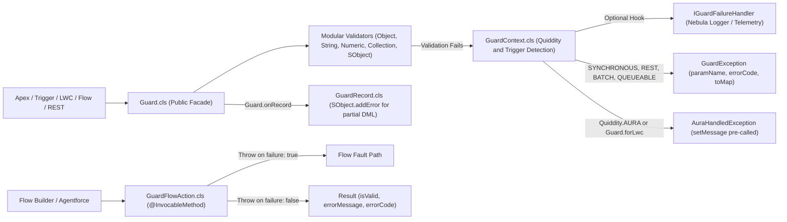

**ApexGuard** provides fail-fast, self-documenting guard clauses that adapt natively across every Salesforce execution context—Apex services, Lightning Web Components, Triggers, Flows, Agentforce Invocable Actions, REST APIs, and Asynchronous Apex.

---

## Why ApexGuard?

Enterprise Apex codebases quickly accumulate defensive `if/else` pyramids (the **"arrow anti-pattern"**), inconsistent exception messages, LWC `"Script-thrown exception"` bugs, and partial-DML trigger crashes.

**ApexGuard**—inspired by Microsoft's `.NET CommunityToolkit.Diagnostics.Guard`—replaces boilerplate defensive branching with a single, positive-assertion `Guard` facade featuring **zero external dependencies**, **zero SOQL/DML**, and **universal runtime awareness**.

<figure class="video-figure">
  <video
    controls
    loading="lazy"
    playsinline
    width="1920"
    height="1080"
    poster="/media/apexguard-demo-poster.webp"
    preload="metadata"
  >
    <source src="/media/apexguard-demo.mp4" type="video/mp4" />
  </video>
  <figcaption>
    45-second HD walkthrough with audio: eliminating the Arrow Anti-Pattern across Apex services,
    LWC controllers, Triggers, and Flows.
  </figcaption>
</figure>

#### Before: The Arrow Anti-Pattern (29 Lines, 4 Nesting Levels)

```apex
public Id processOrder(
    String accountIdStr,
    OrderInput input,
    List<OrderItemInput> items
) {
    if (String.isNotBlank(accountIdStr)) {
        Id parsedId;
        try {
            parsedId = Id.valueOf(accountIdStr);
        } catch (Exception e) {
            throw new IllegalArgumentException(
                'Invalid accountIdStr'
            );
        }
        if (parsedId.getSObjectType() == Account.SObjectType) {
            if (input != null) {
                if (input.amount != null && input.amount > 0) {
                    if (items != null && !items.isEmpty()) {
                        return submitOrder(parsedId, input, items);
                    } else {
                        throw new IllegalArgumentException('No items');
                    }
                } else {
                    throw new IllegalArgumentException('Bad amount');
                }
            } else {
                throw new IllegalArgumentException('Null input');
            }
        } else {
            throw new IllegalArgumentException('Not an Account Id');
        }
    } else {
        throw new IllegalArgumentException('Blank accountIdStr');
    }
}
```

#### After: ApexGuard (7 Lines, 0 Nesting, Pass-Through)

```apex
public Id processOrder(
    String accountIdStr,
    OrderInput input,
    List<OrderItemInput> items
) {
    Id accountId = Guard.isIdOfType(
        Guard.isValidId(accountIdStr, 'accountIdStr'),
        Account.SObjectType,
        'accountIdStr'
    );
    Guard.isNotNull(input, 'input');
    Guard.isGreaterThan(input.amount, 0, 'input.amount');
    Guard.isNotEmpty(items, 'items');

    return submitOrder(accountId, input, items);
}
```

> **Error produced automatically on invalid amount `-5`:**
> `GuardException: Parameter 'input.amount' must be greater than 0, but was -5.`
> Includes structured `getParamName()`, `getErrorCode()`, `getActualValue()`, `getQuiddity()`, `getExecutionContext()`, and `toMap()`.

| Metric                       | Legacy `if/else` Validation                  | **ApexGuard (`Guard`)**                              |
| :--------------------------- | :------------------------------------------- | :--------------------------------------------------- |
| **Precondition Lines**       | 25–35 lines per service method               | **1 line per invariant**                             |
| **Cyclomatic Nesting Depth** | 3–5 levels deep                              | **Flat (0 levels)**                                  |
| **Assignment & Validation**  | Two separate statements                      | **Single-line pass-through return values**           |
| **LWC Error Surface**        | Often fails with `"Script-thrown exception"` | **Auto `AuraHandledException` + `setMessage()`**     |
| **Trigger Bulk Validation**  | Manual `addError()` boilerplate per field    | **Fluent `Guard.onRecord(rec)` partial-DML builder** |
| **SOQL / DML Overhead**      | Custom metadata queries in some frameworks   | **0 SOQL Queries / 0 DML Statements**                |

> [!TIP]
> **Positive Assertion Naming + Pass-Through Return Values:** Every `Guard` method states the **valid condition required to continue** (`Guard.isNotBlank`, `Guard.isGreaterThan`, `Guard.isIdOfType`) and returns the validated value so you can check and assign in one clean expression: `this.accountId = Guard.isValidId(rawId, 'rawId');`

---

## Architecture

At validation failure time, `GuardContext` inspects **`Trigger.isExecuting`** and **`System.Request.getCurrent().getQuiddity()`** (with zero SOQL or DML) and routes failures cleanly for the active Salesforce runtime:



### Modular SFDX Source Layout

Contributors can extend validators, execution-context adapters, or tests cleanly without merge conflicts in [`Guard.cls`](https://github.com/masaner/apex-guard/blob/main/force-app/main/default/classes/core/Guard.cls):

<details>
<summary><strong>Click to expand repository structure</strong></summary>

```text
force-app/main/default/
├── classes/
│   ├── core/
│   │   ├── Guard.cls                     # Single public static facade + pass-through signatures
│   │   └── GuardRecord.cls               # Non-throwing fluent SObject.addError() builder for Triggers
│   ├── context/
│   │   ├── GuardContext.cls              # Quiddity & Trigger runtime detection + LwcScope + dispatch
│   │   └── IGuardFailureHandler.cls      # Global failure hook interface (Nebula Logger, telemetry)
│   ├── exceptions/
│   │   └── GuardException.cls            # Structured exception (paramName, errorCode, toMap())
│   ├── validators/
│   │   ├── GuardObjectValidator.cls      # Nullability & Boolean assertions
│   │   ├── GuardStringValidator.cls      # Empty, Blank, Exact/Max Length, Regex
│   │   ├── GuardNumericValidator.cls     # Greater/Less Than, Range, NotZero (Decimal/Integer/Long)
│   │   ├── GuardCollectionValidator.cls  # List, Set (Id/String/Integer/Object), Map overloads
│   │   ├── GuardSObjectValidator.cls     # isValidId, isIdOfType, isSObjectType, hasPopulatedField
│   │   └── GuardSchemaValidator.cls      # Opt-in running-user CRUD & FLS guards
│   ├── invocable/
│   │   └── GuardFlowAction.cls           # Bulkified @InvocableMethod for Flows & Agentforce
│   └── tests/
│       ├── GuardTest.cls                 # Core validators, boundary cases, custom exceptions, runAs CRUD/FLS
│       ├── GuardContextTest.cls          # Quiddity.AURA, LwcScope, REST/Async metadata, hooks
│       ├── GuardRecordTest.cls           # Partial DML, field addError(), skipInaccessible(), isSet() safety
│       └── GuardFlowActionTest.cls       # Bulk requests, Flow Fault paths, Decision outputs
└── testSuites/
    └── ApexGuard.testSuite-meta.xml      # Salesforce ApexTestSuite bundling all ApexGuard test classes
```

</details>

---

## Quick Start

### Option 1: Install via Unlocked Package (`v1.0.1-1` — Released)

Install directly into any org in one click (no CLI setup required):

- [Unlocked Package Installation (Production / Developer Edition)](https://login.salesforce.com/packaging/installPackage.apexp?p0=04td2000000WkULAA0)
- [Unlocked Package Installation (Sandbox / Scratch Org)](https://test.salesforce.com/packaging/installPackage.apexp?p0=04td2000000WkULAA0)

Or install via Salesforce CLI (`sf`):

```bash
sf package install --package 04td2000000WkULAA0 --security-type AllUsers --apex-compile package --wait 10 --target-org my-org
```

> [!TIP]
> **Recommended Package Install Screen Selections:**
> Choose **Install for All Users** so non-admin users running **Screen Flows** or **Agentforce Actions** automatically have Apex Class Access to `GuardFlowAction` (`@InvocableMethod`), and under **Advanced Options → Apex Compile**, select **Compile only the Apex in the package** so installation finishes in seconds. (Least-privilege orgs can choose **Install for Admins Only** and grant `GuardFlowAction` via a Permission Set.)

### Option 2: Deploy Source via Salesforce CLI (`sf`)

```bash
# 1. Clone the repository
git clone https://github.com/masaner/apex-guard.git
cd apex-guard

# 2. Deploy all classes to your Scratch Org or Sandbox
sf project deploy start --source-dir force-app --target-org my-org

# 3. Verify all 26 unit tests and code coverage using the ApexGuard ApexTestSuite
sf apex run test \
  --suite-names ApexGuard \
  --code-coverage \
  --result-format human \
  --wait 10 \
  --target-org my-org
```

<details>
<summary><strong>30-Second Execute Anonymous Smoke Test (0 SOQL | 0 DML)</strong></summary>

Paste this script into **Developer Console → Debug → Open Execute Anonymous Window** right after installing (`ANONYMOUS` Quiddity compatible):

```apex
// 1. Happy Path: Pass-through validation, LWC pass-through & opt-in schema check
String company = Guard.isNotBlank('Acme Corp', 'company');
String searchKey = Guard.forLwc().isNotBlank('Lightning', 'searchKey');
Decimal discount = Guard.isInRange(15.5, 0, 50, 'discount');
Id sampleAccId = Guard.isIdOfType(
    Guard.isValidId('001000000000000AAA', 'sampleAccId'),
    Account.SObjectType,
    'sampleAccId'
);
Guard.isAccessible(Account.SObjectType);
Guard.isFieldAccessible(Account.Name);
System.debug('1. Happy path passed: ' + company + ' | searchKey=' + searchKey + ' | discount=' + discount + ' | id=' + sampleAccId);

// 2. Fail-Fast GuardException + Structured JSON Metadata (Quiddity = ANONYMOUS)
try {
    Guard.isGreaterThan(-10, 0, 'orderTotal');
} catch (GuardException ex) {
    System.debug('2. Caught GuardException: ' + JSON.serializePretty(ex.toMap()));
}

// 3. Non-Throwing Trigger / Record Validation (Guard.onRecord)
Account invalidAcc = new Account(Name = '   ', NumberOfEmployees = -5);
GuardRecord recCheck = Guard.onRecord(invalidAcc)
    .isNotBlank(Account.Name)
    .isGreaterThan(Account.NumberOfEmployees, 0);
System.debug('3. GuardRecord hasErrors=' + recCheck.hasErrors() + ' | errors=' + recCheck.getErrorMessages());

// 4. Flow & Agentforce Invocable Action (Decision-Routing Mode: throwOnFailure = false)
GuardFlowAction.Request flowReq = new GuardFlowAction.Request();
flowReq.rule = 'IS_GREATER_THAN';
flowReq.paramName = 'AnnualRevenue';
flowReq.numericValue = -500;
flowReq.minValue = 0;
flowReq.throwOnFailure = false;
GuardFlowAction.Result flowRes = GuardFlowAction.validate(new List<GuardFlowAction.Request>{ flowReq })[0];
System.debug('4. Flow Action isValid=' + flowRes.isValid + ' | code=' + flowRes.errorCode + ' | msg=' + flowRes.errorMessage);
```

</details>

> [!NOTE]
> **2GP Unlocked Package (`0Hod2000000768jCAA`):** Configured in [`sfdx-project.json`](https://github.com/masaner/apex-guard/blob/main/sfdx-project.json) (`ApexGuard@1.0.1-1` → `04td2000000WkULAA0`, `sourceApiVersion: 62.0`, 94% package code coverage validated on Salesforce packaging build servers).

---

## AI Agent Skills

ApexGuard publishes **7 official [Agent Skills](https://www.skills.sh/masaner/apex-guard)** so **Antigravity**, Claude Code, Cursor, GitHub Copilot, Codex, and Gemini CLI automatically apply ApexGuard's public APIs, security rules, and `@IsTest` helpers.

```bash
# Install all 7 ApexGuard skills (project scope: ./.agents/skills/)
npx skills add masaner/apex-guard

# Or install globally for Antigravity
npx skills add masaner/apex-guard -g --agent antigravity --skill '*' -y

# Pair with our standalone Spec-Driven Workflow framework (Propose → Explore → Apply → Verify → Archive)
npx skills add masaner/meric-spec -g --agent antigravity --skill '*' -y
```

| Category       | Skill                                                                                                                                              | Coverage                                                                                                                      |
| :------------- | :------------------------------------------------------------------------------------------------------------------------------------------------- | :---------------------------------------------------------------------------------------------------------------------------- |
| **Setup**      | [`apex-guard-install`](https://github.com/masaner/apex-guard/blob/main/skills/apex-guard-install/SKILL.md)                                         | 2GP Unlocked Package (`04td2000000WkULAA0`), SFDX deploy, install options, `ApexTestSuite`, smoke test                        |
| **Usage**      | [`apex-guard-usage`](https://github.com/masaner/apex-guard/blob/main/skills/apex-guard-usage/SKILL.md)                                             | Positive-assertion pass-throughs, `Set`/`Map` overloads, LWC `Quiddity.AURA` & `Guard.forLwc()`, REST/Async `toMap()`         |
| **Usage**      | [`apex-guard-triggers-and-bulk-dml`](https://github.com/masaner/apex-guard/blob/main/skills/apex-guard-triggers-and-bulk-dml/SKILL.md)             | Non-throwing `Guard.onRecord()`, `addError()` accumulation, partial DML (`allOrNone = false`), `.skipInaccessible()`          |
| **Usage**      | [`apex-guard-flows-and-agentforce`](https://github.com/masaner/apex-guard/blob/main/skills/apex-guard-flows-and-agentforce/SKILL.md)               | `GuardFlowAction` `@InvocableMethod`, all 18 rules, Fault paths vs. Decision routing (`throwOnFailure = false`)               |
| **Usage**      | [`apex-guard-testing`](https://github.com/masaner/apex-guard/blob/main/skills/apex-guard-testing/SKILL.md)                                         | Modern `Assert.*`, Stub API (`Test.createStub`) / Apex Mockery, `Guard.forLwc()`, DML-free `GuardRecord`, locale-safe `runAs` |
| **Governance** | [`apex-guard-security-and-best-practices`](https://github.com/masaner/apex-guard/blob/main/skills/apex-guard-security-and-best-practices/SKILL.md) | `inherited sharing`, `isSet()` sparse-SOQL safety, opt-in CRUD/FLS vs. Triggers, 0 SOQL/DML, anti-patterns                    |
| **Extending**  | [`apex-guard-extensibility-and-logging`](https://github.com/masaner/apex-guard/blob/main/skills/apex-guard-extensibility-and-logging/SKILL.md)     | `IGuardFailureHandler`, Nebula Logger (`PublishImmediately` rollback safety), custom exceptions, 30 error constants           |

For copy-paste Antigravity prompts and full CLI workflow details, see our companion guide: [AI Agent Skills (`skills.sh`) & Spec-Driven Workflows](/blog/apex-guard-agent-skills).

---

## Examples by Context

### 1. Apex Services, Constructors & Selectors

Use single-line pass-through return values in constructors, domain objects, and selectors:

```apex
public with sharing class InvoiceCalculatorService {
  private final Id accountId;
  private final Decimal taxRate;
  private final String currencyCode;

  public InvoiceCalculatorService(
    String rawAccountId,
    Decimal taxRate,
    String currencyCode,
    Account billedAccount
  ) {
    this.accountId = Guard.isIdOfType(
      Guard.isValidId(rawAccountId, 'rawAccountId'),
      Account.SObjectType,
      'rawAccountId'
    );
    this.taxRate = Guard.isInRange(taxRate, 0, 1, 'taxRate');
    this.currencyCode = Guard.hasLengthEqualTo(
      Guard.isNotBlank(currencyCode, 'currencyCode'),
      3,
      'currencyCode'
    );

    // Safely verifies field is BOTH queried/set in memory AND non-null
    Guard.hasPopulatedField(billedAccount, Account.BillingCountry, 'billedAccount');
  }
}
```

> [!IMPORTANT]
> **Preventing Sparse-SOQL Crashes (`SObject.isSet()`):** Calling `record.get(field)` on an unqueried field throws `System.SObjectException`. Both `Guard.hasPopulatedField(...)` and `Guard.onRecord(...)` inspect `record.isSet(field)` first and convert missing fields into clean validation errors (`GUARD_UNPOPULATED_FIELD` or field `addError`).

### 2. Lightning Web Components (`@AuraEnabled` + LWC JS)

When Apex executes inside an Aura/LWC request (`System.Quiddity.AURA`), `Guard` **automatically** throws `AuraHandledException` instead of `GuardException`. You can also invoke `Guard.forLwc()` explicitly in shared helper methods or tests:

```apex
// Apex Controller — BudgetController.cls
public with sharing class BudgetController {
  @AuraEnabled
  public static Account updateQuarterlyBudget(String accountIdStr, Decimal budget) {
    // Explicit scope or automatic Quiddity.AURA detection — both call setMessage()!
    Id accountId = Guard.forLwc()
      .isIdOfType(
        Guard.forLwc().isValidId(accountIdStr, 'accountIdStr'),
        Account.SObjectType,
        'accountIdStr'
      );
    // Opt-in running-user CRUD & FLS enforcement (useful in @AuraEnabled / user-mode entry points)
    Guard.forLwc().isUpdateable(Account.SObjectType);
    Guard.forLwc().isFieldUpdateable(Account.AnnualRevenue);
    Guard.forLwc().isGreaterThan(budget, 0, 'budget');

    Account acc = new Account(Id = accountId, AnnualRevenue = budget);
    update as user acc;
    return acc;
  }
}
```

```javascript
// Lightning Web Component — budgetEditor.js
import { LightningElement } from 'lwc';
import { ShowToastEvent } from 'lightning/platformShowToastEvent';
import updateQuarterlyBudget from '@salesforce/apex/BudgetController.updateQuarterlyBudget';

export default class BudgetEditor extends LightningElement {
  async handleSave() {
    try {
      await updateQuarterlyBudget({
        accountIdStr: this.recordId,
        budget: this.budgetAmount,
      });
    } catch (error) {
      // Displays the exact message: "Parameter 'budget' must be greater than 0, but was -500."
      const message = error?.body?.message || 'Unexpected error';
      this.dispatchEvent(
        new ShowToastEvent({ title: 'Validation Error', message, variant: 'error' }),
      );
    }
  }
}
```

> [!NOTE]
> **Solving the `"Script-thrown exception"` Trap:** In Salesforce Apex, `throw new AuraHandledException(msg)` omits `msg` unless `auraEx.setMessage(msg)` is called immediately afterward. `GuardContext.createAuraHandledException()` always invokes `setMessage()`, guaranteeing readable client toasts and deterministic `@IsTest` assertions.

### 3. Apex Triggers & Partial DML (`Guard.onRecord`)

Combine **fail-fast structural guards** (`Guard.isNotEmpty(Trigger.new, ...)`) with **non-throwing record validation** (`Guard.onRecord(record)`), attaching field-level `addError()` messages directly inside Lightning Record Pages while letting valid records succeed under `Database.insert(records, false)`.

```apex
public with sharing class AccountTriggerHandler {
  public static void beforeSave(List<Account> newAccounts) {
    // Structural precondition: fails fast if called improperly with empty/null batch
    Guard.isNotEmpty(newAccounts, 'newAccounts');

    for (Account acc : newAccounts) {
      Guard.onRecord(acc)
        .isNotBlank(Account.Name, 'Account Name is required.')
        .isGreaterThan(Account.AnnualRevenue, 0, 'Annual Revenue must be positive.')
        .hasMaxLength(Account.TickerSymbol, 5)
        .matchesRegex(Account.AccountNumber, '^ACC-[0-9]{4}$')
        .hasPopulatedField(Account.Industry);
    }
  }
}
```

<details>
<summary><strong>See Partial DML, Opt-In FLS Filtering (<code>skipInaccessible()</code>) &amp; Inspection Example</strong></summary>

```apex
GuardRecord validator = Guard.onRecord(acc)
    .isNotBlank(Account.Name, 'Account Name is required.')
    .isInRange(Account.NumberOfEmployees, 1, 100000);

// Optional opt-in mode for user-context controllers/flows where restricted users
// should not trigger validation failures on hidden FLS fields:
GuardRecord userContextValidator = Guard.onRecord(acc)
    .skipInaccessible()
    .isGreaterThan(Account.AnnualRevenue, 0);

if (validator.hasErrors()) {
    List<String> chronologicalMessages = validator.getErrorMessages();
    // Errors are already attached to Account.Name / Account.NumberOfEmployees via SObject.addError()
}

// Valid records in the same Trigger/DML batch commit normally!
Database.SaveResult[] results = Database.insert(accounts, false);
```

</details>

### 4. Declarative Flows & Agentforce Actions (`GuardFlowAction`)

Search for **`Validate Input (ApexGuard)`** (`GuardFlowAction`) in Flow Builder or Agentforce Action Configuration:

| Flow Use Case                            | `Throw On Failure` Setting | Behavior                                                                                                                                                                                        |
| :--------------------------------------- | :------------------------: | :---------------------------------------------------------------------------------------------------------------------------------------------------------------------------------------------- |
| **Fail-Fast / Fault Path**               |     `true` _(default)_     | Rolls back transaction on invalid input and triggers your Flow **Fault Connector** with full diagnostic details.                                                                                |
| **Decision Branching / Agentforce Loop** |          `false`           | Never throws! Returns `isValid = false`, `errorMessage`, `errorCode`, `paramName`, and `executionContext` so Flows route via Decision elements or Agentforce prompts the user to fix the input. |

<details>
<summary><strong>Click to view all Flow Action Inputs, Outputs &amp; 18 Supported Rules</strong></summary>

#### Invocable Request Inputs (`GuardFlowAction.Request`)

- `rule` _(required)_: Rule identifier (case-insensitive)
- `paramName`: Logical parameter or field label for diagnostics
- `stringValue`, `numericValue`, `booleanValue`, `recordValue`: Typed value inputs
- `comparisonValue`: Regex pattern, SObject API name (e.g., `Account`), or string-encoded threshold
- `minValue`, `maxValue`, `integerValue`: Numeric range or string length bounds
- `customMessage`: Optional custom override message
- `throwOnFailure`: Boolean (`true` default = throw; `false` = return `Result`)

#### Invocable Response Outputs (`GuardFlowAction.Result`)

- `isValid` (`Boolean`), `errorMessage` (`String`), `errorCode` (`String`), `paramName` (`String`), `executionContext` (`String`)

#### All 18 Supported Flow / Agentforce Rules

`IS_NOT_NULL` • `IS_NULL` • `IS_TRUE` • `IS_FALSE` • `IS_NOT_EMPTY` • `IS_NOT_BLANK` • `HAS_LENGTH_EQUAL_TO` • `HAS_MAX_LENGTH` • `MATCHES_REGEX` • `IS_GREATER_THAN` • `IS_GREATER_THAN_OR_EQUAL_TO` • `IS_LESS_THAN` • `IS_LESS_THAN_OR_EQUAL_TO` • `IS_IN_RANGE` • `IS_NOT_ZERO` • `IS_VALID_ID` • `IS_ID_OF_TYPE` • `IS_SOBJECT_TYPE`

</details>

### 5. REST APIs & Asynchronous Apex (`TransactionFinalizer`)

`GuardException` captures runtime metadata automatically (`getParamName()`, `getErrorCode()`, `getActualValue()`, `getQuiddity()`, `getExecutionContext()`, and `toMap()`), eliminating fragile exception-message string parsing in APIs and Async finalizers:

```apex
@RestResource(urlMapping='/v1/orders/*')
global with sharing class OrderRestEndpoint {
  @HttpPost
  global static void createOrder(String accountId, Decimal amount) {
    RestResponse res = RestContext.response;
    try {
      Id validAccountId = Guard.isIdOfType(
        Guard.isValidId(accountId, 'accountId'),
        Account.SObjectType,
        'accountId'
      );
      Guard.isGreaterThan(amount, 0, 'amount');

      // Process order...
      res.statusCode = 201;
    } catch (GuardException ex) {
      res.statusCode = 400;
      res.addHeader('Content-Type', 'application/json');
      res.responseBody = Blob.valueOf(JSON.serialize(ex.toMap()));
    }
  }
}
```

**Structured JSON Error Response (`ex.toMap()`):**

```json
{
  "message": "Parameter 'amount' must be greater than 0, but was -25.",
  "paramName": "amount",
  "errorCode": "GUARD_GREATER_THAN",
  "actualValue": -25,
  "quiddity": "REST",
  "executionContext": "REST"
}
```

<details>
<summary><strong>See Queueable + <code>System.Finalizer</code> Async Diagnostics Example</strong></summary>

```apex
public class OrderSyncQueueable implements Queueable, System.Finalizer {
  private final Id orderId;

  public OrderSyncQueueable(String rawOrderId) {
    this.orderId = Guard.isValidId(rawOrderId, 'rawOrderId');
  }

  public void execute(QueueableContext context) {
    System.attachFinalizer(this);
    // Perform sync...
  }

  public void execute(FinalizerContext context) {
    if (context.getResult() == ParentJobResult.UNHANDLED_EXCEPTION) {
      Exception ex = context.getException();
      if (ex instanceof GuardException) {
        Map<String, Object> diagnostics = ((GuardException) ex).toMap();
        // Publish structured GuardException metadata to Platform Event / Log object
      }
    }
  }
}
```

</details>

### 6. Custom Domain Exceptions & Nebula Logger (`IGuardFailureHandler`)

Override failures per call site with a custom message or domain `Exception`, or register a transaction-wide `IGuardFailureHandler` for **Nebula Logger** or global exception translation:

```apex
// Per-call custom Exception overload
Guard.isGreaterThan(
    availableCredit,
    0,
    new InsufficientCreditException('Customer credit balance is exhausted.')
);

// Per-call custom message (retains GuardException paramName, errorCode, & Quiddity)
Guard.isNotBlank(externalKey, 'externalKey', 'External ERP key must be supplied.');
```

<details>
<summary><strong>See Complete Nebula Logger &amp; Telemetry Hook Example (<code>IGuardFailureHandler</code>)</strong></summary>

```apex
public class NebulaGuardFailureHandler implements IGuardFailureHandler {
    public void handleFailure(GuardContext.Failure failure) {
        // Optional adapter — zero Nebula dependency in ApexGuard core:
        // Logger.error(failure.message + ' | Context=' + failure.executionContext)
        //       .addTag(failure.errorCode);
        // Logger.saveLog();

        // Or serialize full failure metadata safely:
        System.debug(
            LoggingLevel.ERROR,
            JSON.serialize(failure.toGuardException().toMap())
        );
    }
}

// Register at transaction entry point (Trigger Dispatcher, REST Controller, Batch.start):
Guard.setFailureHandler(new NebulaGuardFailureHandler());
```

</details>

---

## API Reference

Every guard method on [`Guard.cls`](https://github.com/masaner/apex-guard/blob/main/force-app/main/default/classes/core/Guard.cls) supports three overloads: default diagnostic message `(..., paramName)`, custom message `(..., paramName, customMessage)`, and explicit exception `(..., customException)` (boolean assertions omit `paramName` and accept `message` or `customException`).

| Category                                               | Method                                                                 | Returns                          | Error Code Constant       |
| :----------------------------------------------------- | :--------------------------------------------------------------------- | :------------------------------- | :------------------------ |
| **Nullability**                                        | `Guard.isNotNull(value, paramName)`                                    | `Object`                         | `GUARD_NULL_VALUE`        |
|                                                        | `Guard.isNull(value, paramName)`                                       | `Object` (`null`)                | `GUARD_NOT_NULL_VALUE`    |
| **Boolean / State**                                    | `Guard.isTrue(condition, message)`                                     | `Boolean` (`true`)               | `GUARD_TRUE_EXPECTED`     |
|                                                        | `Guard.isFalse(condition, message)`                                    | `Boolean` (`false`)              | `GUARD_FALSE_EXPECTED`    |
| **Strings**                                            | `Guard.isNotEmpty(value, paramName)`                                   | `String`                         | `GUARD_EMPTY_STRING`      |
|                                                        | `Guard.isNotBlank(value, paramName)`                                   | `String`                         | `GUARD_BLANK_STRING`      |
|                                                        | `Guard.hasLengthEqualTo(value, expectedLength, paramName)`             | `String`                         | `GUARD_STRING_LENGTH`     |
|                                                        | `Guard.hasMaxLength(value, maxLength, paramName)`                      | `String`                         | `GUARD_MAX_LENGTH`        |
|                                                        | `Guard.matchesRegex(value, regexPattern, paramName)`                   | `String`                         | `GUARD_REGEX_MISMATCH`    |
| **Numeric** _(`Decimal`, `Integer`, `Long`, `Double`)_ | `Guard.isGreaterThan(value, minExclusive, paramName)`                  | `Decimal` / `Integer` / `Long`   | `GUARD_GREATER_THAN`      |
|                                                        | `Guard.isGreaterThanOrEqualTo(value, minInclusive, paramName)`         | `Decimal` / `Integer` / `Long`   | `GUARD_GREATER_OR_EQUAL`  |
|                                                        | `Guard.isLessThan(value, maxExclusive, paramName)`                     | `Decimal` / `Integer` / `Long`   | `GUARD_LESS_THAN`         |
|                                                        | `Guard.isLessThanOrEqualTo(value, maxInclusive, paramName)`            | `Decimal` / `Integer` / `Long`   | `GUARD_LESS_OR_EQUAL`     |
|                                                        | `Guard.isInRange(value, minInclusive, maxInclusive, paramName)`        | `Decimal` / `Integer` / `Long`   | `GUARD_OUT_OF_RANGE`      |
|                                                        | `Guard.isNotZero(value, paramName)`                                    | `Decimal` / `Integer` / `Long`   | `GUARD_ZERO_VALUE`        |
| **Collections** _(Zero-copy `Set` & `Map`)_            | `Guard.isNotEmpty(collection, paramName)`                              | `List` / `Set` / `Map`           | `GUARD_EMPTY_COLLECTION`  |
|                                                        | `Guard.hasSizeEqualTo(collection, expectedSize, paramName)`            | `List` / `Set` / `Map`           | `GUARD_COLLECTION_SIZE`   |
|                                                        | `Guard.containsKey(inputMap, key, paramName)`                          | `Map`                            | `GUARD_MISSING_KEY`       |
| **Salesforce-Native**                                  | `Guard.isValidId(value, paramName)`                                    | `Id`                             | `GUARD_INVALID_ID`        |
|                                                        | `Guard.isIdOfType(recordId, expectedType, paramName)`                  | `Id`                             | `GUARD_ID_SOBJECT_TYPE`   |
|                                                        | `Guard.isSObjectType(record, expectedType, paramName)`                 | `SObject`                        | `GUARD_SOBJECT_TYPE`      |
|                                                        | `Guard.hasPopulatedField(record, field, paramName)`                    | `SObject`                        | `GUARD_UNPOPULATED_FIELD` |
| **Schema CRUD & FLS** _(Opt-in, 0 SOQL)_               | `Guard.isAccessible` / `isCreateable` / `isUpdateable` / `isDeletable` | `Schema.SObjectType`             | `GUARD_SOBJECT_NOT_*`     |
|                                                        | `Guard.isFieldAccessible` / `isFieldCreateable` / `isFieldUpdateable`  | `Schema.SObjectField`            | `GUARD_FIELD_NOT_*`       |
| **Context & Hooks**                                    | `Guard.onRecord(record)` _(with `.skipInaccessible()` & FLS checks)_   | `GuardRecord`                    | Field/Record `addError()` |
|                                                        | `Guard.forLwc()` / `Guard.disableLwcMode()`                            | `GuardContext.LwcScope` / `void` | `AuraHandledException`    |
|                                                        | `Guard.setAutoDetectAuraQuiddity(enabled)`                             | `void`                           | Context config            |
|                                                        | `Guard.setFailureHandler(handler)` / `Guard.resetFailureHandler()`     | `void`                           | `IGuardFailureHandler`    |
|                                                        | `Guard.resetContext()`                                                 | `void`                           | Resets transaction config |

> [!TIP]
> **Apex `Set` & `Map` Ergonomics:** Because Apex `Set<T>` is invariant and `Map<K, V>` keys are invariant, `Guard` ships explicit overloads for `Set<Id>`, `Set<String>`, `Set<Integer>`, `Set<Object>`, `Map<Id, SObject>`, `Map<String, Object>`, `Map<String, String>`, and `Map<Object, Object>`—zero wrapper allocations required (`Guard.isNotEmpty(accountIds, 'accountIds')` works directly!). Note: `hasSizeEqualTo` supports `List<Object>`, `Set<Id/String/Object>`, and `Map<Id, SObject>` / `Map<String, Object>` / `Map<Object, Object>`.

<details>
<summary><strong>Click to view all 30 Standardized Error Code Constants (<code>GuardException</code>)</strong></summary>

| Constant                              | String Value               | Constant                                    | String Value                     |
| :------------------------------------ | :------------------------- | :------------------------------------------ | :------------------------------- |
| `GuardException.ERR_NULL_VALUE`       | `'GUARD_NULL_VALUE'`       | `GuardException.ERR_COLLECTION_SIZE`        | `'GUARD_COLLECTION_SIZE'`        |
| `GuardException.ERR_NOT_NULL_VALUE`   | `'GUARD_NOT_NULL_VALUE'`   | `GuardException.ERR_MISSING_KEY`            | `'GUARD_MISSING_KEY'`            |
| `GuardException.ERR_TRUE_EXPECTED`    | `'GUARD_TRUE_EXPECTED'`    | `GuardException.ERR_INVALID_ID`             | `'GUARD_INVALID_ID'`             |
| `GuardException.ERR_FALSE_EXPECTED`   | `'GUARD_FALSE_EXPECTED'`   | `GuardException.ERR_ID_SOBJECT_TYPE`        | `'GUARD_ID_SOBJECT_TYPE'`        |
| `GuardException.ERR_EMPTY_STRING`     | `'GUARD_EMPTY_STRING'`     | `GuardException.ERR_SOBJECT_TYPE`           | `'GUARD_SOBJECT_TYPE'`           |
| `GuardException.ERR_BLANK_STRING`     | `'GUARD_BLANK_STRING'`     | `GuardException.ERR_UNPOPULATED_FIELD`      | `'GUARD_UNPOPULATED_FIELD'`      |
| `GuardException.ERR_STRING_LENGTH`    | `'GUARD_STRING_LENGTH'`    | `GuardException.ERR_SOBJECT_NOT_ACCESSIBLE` | `'GUARD_SOBJECT_NOT_ACCESSIBLE'` |
| `GuardException.ERR_MAX_LENGTH`       | `'GUARD_MAX_LENGTH'`       | `GuardException.ERR_SOBJECT_NOT_CREATEABLE` | `'GUARD_SOBJECT_NOT_CREATEABLE'` |
| `GuardException.ERR_REGEX_MISMATCH`   | `'GUARD_REGEX_MISMATCH'`   | `GuardException.ERR_SOBJECT_NOT_UPDATEABLE` | `'GUARD_SOBJECT_NOT_UPDATEABLE'` |
| `GuardException.ERR_GREATER_THAN`     | `'GUARD_GREATER_THAN'`     | `GuardException.ERR_SOBJECT_NOT_DELETABLE`  | `'GUARD_SOBJECT_NOT_DELETABLE'`  |
| `GuardException.ERR_GREATER_OR_EQUAL` | `'GUARD_GREATER_OR_EQUAL'` | `GuardException.ERR_FIELD_NOT_ACCESSIBLE`   | `'GUARD_FIELD_NOT_ACCESSIBLE'`   |
| `GuardException.ERR_LESS_THAN`        | `'GUARD_LESS_THAN'`        | `GuardException.ERR_FIELD_NOT_CREATEABLE`   | `'GUARD_FIELD_NOT_CREATEABLE'`   |
| `GuardException.ERR_LESS_OR_EQUAL`    | `'GUARD_LESS_OR_EQUAL'`    | `GuardException.ERR_FIELD_NOT_UPDATEABLE`   | `'GUARD_FIELD_NOT_UPDATEABLE'`   |
| `GuardException.ERR_OUT_OF_RANGE`     | `'GUARD_OUT_OF_RANGE'`     | `GuardException.ERR_INVALID_GUARD_ARGUMENT` | `'GUARD_INVALID_ARGUMENT'`       |
| `GuardException.ERR_ZERO_VALUE`       | `'GUARD_ZERO_VALUE'`       | `GuardException.ERR_EMPTY_COLLECTION`       | `'GUARD_EMPTY_COLLECTION'`       |

</details>

---

## Test Coverage

Verified on Salesforce API `v62.0` (Test Run ID `707d200001GFUM4AAP` — **26/26 tests passing**, **100% pass rate**, **2,366 ms** total runtime, using modern `Assert.*`, native `System.StubProvider` / `Test.createStub`, locale-safe `System.runAs`, and `Security.stripInaccessible` verification):

| Apex Class                                                                                                                                               | Responsibility                                              | Verified Coverage |
| :------------------------------------------------------------------------------------------------------------------------------------------------------- | :---------------------------------------------------------- | :---------------: |
| [`GuardException.cls`](https://github.com/masaner/apex-guard/blob/main/force-app/main/default/classes/exceptions/GuardException.cls)                     | Structured exception & `toMap()` serialization              |     **100%**      |
| [`GuardStringValidator.cls`](https://github.com/masaner/apex-guard/blob/main/force-app/main/default/classes/validators/GuardStringValidator.cls)         | String empty/blank/length/regex validation                  |     **100%**      |
| [`GuardSchemaValidator.cls`](https://github.com/masaner/apex-guard/blob/main/force-app/main/default/classes/validators/GuardSchemaValidator.cls)         | Opt-in running-user CRUD & FLS guards                       |     **100%**      |
| [`GuardContext.cls`](https://github.com/masaner/apex-guard/blob/main/force-app/main/default/classes/context/GuardContext.cls)                            | `Quiddity` & Trigger resolution + `LwcScope` + hooks        |      **99%**      |
| [`Guard.cls`](https://github.com/masaner/apex-guard/blob/main/force-app/main/default/classes/core/Guard.cls)                                             | Public facade entry point                                   |      **97%**      |
| [`GuardObjectValidator.cls`](https://github.com/masaner/apex-guard/blob/main/force-app/main/default/classes/validators/GuardObjectValidator.cls)         | Object nullability & Boolean state assertions               |      **97%**      |
| [`GuardCollectionValidator.cls`](https://github.com/masaner/apex-guard/blob/main/force-app/main/default/classes/validators/GuardCollectionValidator.cls) | List, Set & Map covariance validation                       |      **95%**      |
| [`GuardNumericValidator.cls`](https://github.com/masaner/apex-guard/blob/main/force-app/main/default/classes/validators/GuardNumericValidator.cls)       | Bounds, inclusive range & non-zero checks                   |      **95%**      |
| [`GuardSObjectValidator.cls`](https://github.com/masaner/apex-guard/blob/main/force-app/main/default/classes/validators/GuardSObjectValidator.cls)       | Id parsing, SObjectType & `isSet()` field checks            |      **94%**      |
| [`GuardRecord.cls`](https://github.com/masaner/apex-guard/blob/main/force-app/main/default/classes/core/GuardRecord.cls)                                 | Fluent Trigger `addError()` & `.skipInaccessible()` builder |      **91%**      |
| [`GuardFlowAction.cls`](https://github.com/masaner/apex-guard/blob/main/force-app/main/default/classes/invocable/GuardFlowAction.cls)                    | Flow & Agentforce `@InvocableMethod`                        |      **83%**      |
